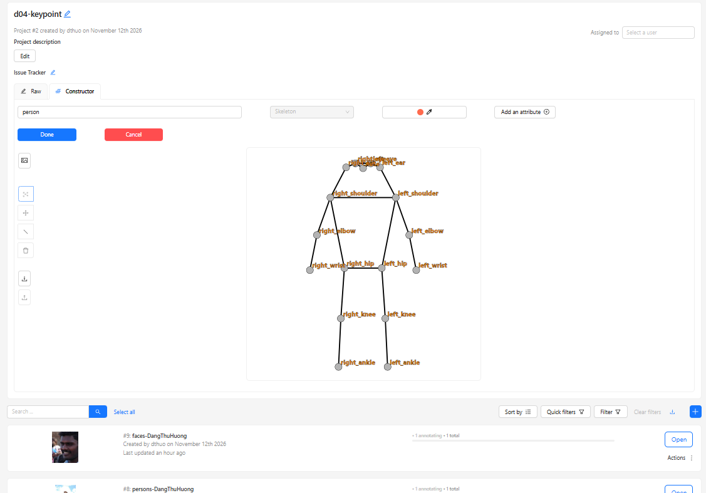
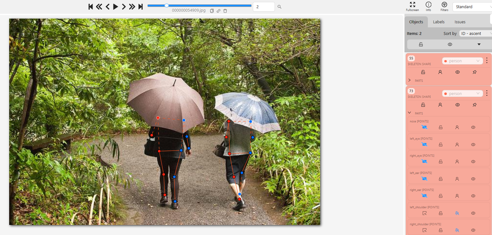
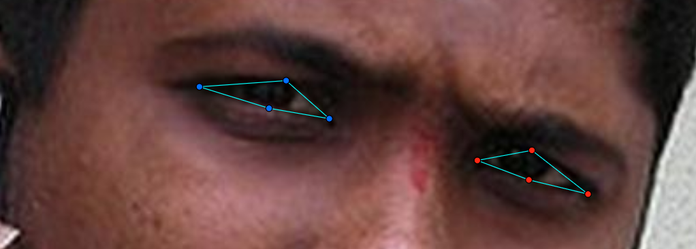
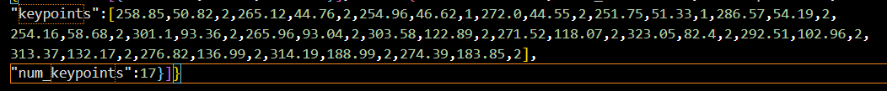

# Báo cáo cá nhân — DangThuHuong-202603047

Đổi tên file theo quy tắc `MSSV_HoTen.md`. Ví dụ: `20241234_NguyenVanAn.md`.

Dữ liệu: 12 ảnh người COCO val2017 (Lin et al., 2014) và 8 ảnh chân dung Wikimedia Commons, chỉ dùng trong lớp.

## 0. Thông tin học viên

- Họ tên:
- MSSV: 202603047
- Email:
- Link repository: https://github.com/emdua24-hub/K5-L2-DAY04-DangThuHuong-2A202603047-KeypointPose
- Phiên bản CVAT (Help → About): 2.74.1 (server và UI)
- Máy: hệ điều hành Windows · RAM ___ GB · chạy CVAT chế độ đầy đủ / lite
- Bộ ảnh (`src/exports/assignment.json` do `lab.py setup` tạo): có / không
- Giờ bắt đầu:
- Giờ kết thúc:

## 1. Kiểm tra label (CP0)

| Label | Kiểu | Số điểm | Tên điểm đúng bảng của lab? | Đúng thứ tự? | Số cạnh |
|---|---|---:|---|---|---:|
| `person` | Skeleton | 17 | Có | Có | 19 |
| `face` | Skeleton | 13 | Có | Có | 13 |

Mẫu `person` dựng theo người quay mặt về camera (các điểm `left_*` nằm bên phải khung mẫu)? Có

Cách đổi cờ `occluded` / `outside` cho **một điểm** trên phiên bản CVAT này (một câu):

Trên CVAT 2.74.1: rê chuột vào đúng điểm cho sáng lên rồi bấm `Q` (occluded, điểm thành vòng rỗng, cạnh nối nét đứt) hoặc `O` (outside, điểm biến mất), hoặc chuột phải vào điểm và chọn trong menu; chỉ điểm đó đổi cờ.

## 2. Số lượng đã gán và thời gian (CP1, CP2)

| Nhóm ảnh | Số ảnh | Số skeleton đã gán | Số người dưới 60 px (không gán) | Số poster / gương / màn hình bỏ qua | Thời gian (phút) |
|---|---:|---:|---:|---:|---:|
| `easy` | 5 | 5 | 1 | 1 | ~11 |
| `occluded` | 3 | 6 | 0 | 0 | ~10 |
| `back` | 2 | 4 | 0 | 0 | ~8 |
| `small` | 1 | 2 | 0 | 0 | ~4 |
| `crowd` | 1 | 3 | 0 | 0 | ~7 |
| `faces` | 8 | 8 | — | 0 | ~15 |

Thời gian là ước lượng (không bấm giờ khi làm): tổng CP1 khoảng 40 phút, chia theo độ khó từng nhóm.

- Số ảnh người đã xong ở mốc phút 105: 10 / 10 (làm theo nhịp riêng, xong cả 12 ảnh người khoảng 40 phút sau khi bắt đầu)
- Thời gian thực tế (phút, ước lượng): CP1 ~40 · CP2 ~15 · CP3 ~10
- Ảnh tốn thời gian nhất là ảnh nào, vì sao?

`000000522889.jpg` (nhóm `crowd`, sân tennis). Ảnh có nhiều người cần gán nhất trong bộ (3 skeleton): tay vợt ở giữa và hai người đứng chồng lên nhau ở phía sau. Tay vợt có tư thế phức tạp: hai tay vắt chéo sang một bên khi đánh bóng, chân trái co ra sau và bắt chéo sau chân trụ, nên phải lần theo từng chi từ vai, hông để đặt đúng trái/phải. Hai người phía sau che nhau và người đứng sau bị cắt ở mép trên ảnh, nên phải cân nhắc từng điểm nên để `v = 1` (bị che nhưng ước lượng chắc) hay `v = 0` (ngoài ảnh hoặc không đoán được).

## 3. Bảng ca khó (CP1, CP2)

Mỗi điểm bạn phân vân một dòng, nhất là phân vân giữa `v = 1` và `v = 0`, hoặc không chắc hướng người.

| Ảnh | Người / mặt | Điểm | Cờ đã chọn | Phân vân giữa | Lý do chọn |
|---|---|---|---:|---|---|
| `000000019754.jpg` | Người 1 (cô gái nhảy ván) | `left_knee` | outside (`v = 0`) | `v = 1` / `v = 0` | Không đoán được gối trái ở đâu |
| `000000019754.jpg` | Người 1 (cô gái nhảy ván) | `left_ankle` | outside (`v = 0`) | `v = 1` / `v = 0` | Không đoán được cổ chân trái ở đâu |
| `000000030960.jpg` | Cô dâu | `right_knee` | occluded (`v = 1`) | `v = 1` / `v = 0` | Ước lượng được vị trí gối phải ở chỗ đó |
| `000000122199.jpg` | Người leo núi (phía trước) | `right_hip` | outside (`v = 0`) | `v = 1` / `v = 0` | Không thấy hông phải của anh ấy trong ảnh |

## 4. Bảng tự review (CP3)

Đi từ ảnh cuối về ảnh đầu. 5 ảnh người (ít nhất 2 ảnh `back` hoặc `crowd`) và 3 ảnh mặt. Ít nhất 8 dòng, kể cả dòng `ok`. Ghi lỗi trước, sửa sau.

Mã lỗi dùng đúng một trong: `lr_swap`, `vis_flag`, `position`, `missing`, `extra`, `ok`.

| Ảnh | Người / mặt | Điểm | Mã lỗi | Ghi chú | Đã sửa? |
|---|---|---|---|---|---|
| `000000522889.jpg` | Người 3 (đứng sau, bị cắt mép trên) | `right_shoulder` | `vis_flag` | Để `v = 1` sát mép trên (y ≈ 1), khớp thật nằm ngoài ảnh → đổi sang outside | Có |
| `000000522889.jpg` | Người 3 (đứng sau, bị cắt mép trên) | `left_shoulder` | `vis_flag` | Để `v = 2` sát mép trên (y ≈ 1), khớp thật nằm ngoài ảnh → đổi sang outside | Có |
| `000000522889.jpg` | Người 1 (tay vợt) | cặp `ankle` | `ok` | Script cảnh báo ngược phía: chân trái co ra sau, bắt chéo sau chân trụ thật, không phải `lr_swap` | — |
| `000000308257.jpg` | Người 1 (ngồi xếp bằng) | `right_ankle` | `position` | Đặt ở giữa ống chân → kéo về cổ chân, ngay trước quai sandal | Có |
| `000000122199.jpg` | Người leo núi (phía trước) | cặp `knee` | `ok` | Script cảnh báo ngược phía: người nghiêng nhìn sang trái ảnh, chân trái (gần camera) bước lên trước | — |
| `000000054909.jpg` | 2 người quay lưng | — | `ok` | Điểm `left_*` nằm bên trái ảnh, mặt không thấy để outside | — |
| `000000019754.jpg` | Người 1 (nhảy ván) | `right_hip` | `position` | Đặt ở mép ngoài mông → kéo vào trong về phía khớp hông | Có |
| `000000019754.jpg` | Người 1 (nhảy ván) | `right_ankle` | `vis_flag` | Để `v = 2` dù cổ chân bị tấm ván che → đổi sang occluded | Có |
| `face_324513.jpg` | Mặt 1 (kính râm) | `right_eye_*` (4 điểm) | `vis_flag` | Để `v = 2` dù mắt nằm sau kính râm tối → đổi sang occluded | Có |
| `face_324513.jpg` | Mặt 1 (kính râm) | `right_eye_*` | `position` | Khung mắt vẽ quá rộng, khóe ngoài nằm trên càng kính → thu vào trong tròng kính | (điền Có/Không) |
| (ảnh mặt thứ 2) | Mặt 1 | — | `ok` | (điền sau khi tự kiểm) | — |
| (ảnh mặt thứ 3) | Mặt 1 | — | `ok` | (điền sau khi tự kiểm) | — |

Tổng hợp số lỗi theo mã:

| `lr_swap` | `vis_flag` | `position` | `missing` | `extra` | `ok` |
|---:|---:|---:|---:|---:|---:|
| 0 | 4 | 3 | 0 | 0 | 5 |

Điểm còn phân vân giữa `v = 1` và `v = 0` (ghi cả hai lựa chọn và lý do chọn):

- `000000030960.jpg`, cô dâu, `right_knee`: phân vân `v = 1` / `v = 0`, chọn `v = 1` vì ước lượng được vị trí gối phải.
- `000000019754.jpg`, cô gái nhảy ván, `left_knee` và `left_ankle`: phân vân `v = 1` / `v = 0`, chọn `v = 0` vì bị tấm ván che và không đoán được vị trí.

## 5. Kiểm file xuất và kết quả tự kiểm (CP4)

Tự kiểm tay trong file JSON:

| File | Người / mặt kiểm (ảnh, thứ tự) | Số phần tử `keypoints` | Điểm `outside` ra `v = 0`, `occluded` ra `v = 1`? | `num_keypoints` khớp? |
|---|---|---:|---|---|
| `DangThuHuong_persons.zip` | `000000019754.jpg`, người 1 | 51 | Có: `left_knee`, `left_ankle` (outside) ra `v = 0`; `left_hip`, `right_ankle` (occluded) ra `v = 1` | Có: `num_keypoints` = 15 = số điểm `v > 0` |
| `DangThuHuong_persons.zip` | `000000522889.jpg`, người 3 (bị cắt ở mép trên) | 51 | Có: 10 điểm `v = 0` (đầu ngoài ảnh, hai vai…), 3 điểm `v = 1` | Có: `num_keypoints` = 7 = số điểm `v > 0` |
| `DangThuHuong_faces.zip` | `face_324513.jpg` (kính râm), mặt 1 | 39 | Có: 8 điểm mắt sau kính râm (occluded) ra `v = 1` | Có: `num_keypoints` = 13 |

Sau khi xuất, CVAT ghi `occluded` thành `v = 1` và `outside` thành `v = 0`. Tọa độ của điểm `outside` trong file là `0, 0` hay tọa độ cũ? Tọa độ cũ (ví dụ `nose` của người 3 ảnh `000000522889.jpg` ghi `262.37, -14.64, 0`).

Hai job đã chuyển sang completed trên CVAT? Có / Không

Dán phần **TÓM TẮT** in ra từ `src/check_submission.py`:

```text
- File person: DangThuHuong_persons.zip
  Số ảnh: 12 · số skeleton `person`: 20 · mỗi annotation 51 số
  Skeleton theo ảnh: 000000019754=1, 000000030960=2, 000000054909=2, 000000072098=1, 000000100510=2, 000000122199=2, 000000162046=1, 000000308257=1, 000000455536=1, 000000516902=2, 000000518966=2, 000000522889=3
  Cờ v: v=2 229 (67%) · v=1 39 (11%) · v=0 72 (21%)
  num_keypoints trung bình: 13.4
- File face: DangThuHuong_faces.zip
  Số ảnh: 8 · số skeleton `face`: 8 · mỗi annotation 39 số
  Skeleton theo ảnh: face_145621=1, face_196742=1, face_257657=1, face_264124=1, face_324513=1, face_38721=1, face_425647=1, face_575921=1
  Cờ v: v=2 96 (92%) · v=1 8 (8%) · v=0 0 (0%)
  num_keypoints trung bình: 13.0
- Ghi chú: 72 điểm v = 0 vẫn mang tọa độ cũ (CVAT 2.x xuất như vậy; chuẩn COCO ghi 0, 0). Không phải lỗi: điểm v = 0 bị bỏ qua khi huấn luyện và khi chấm.
- Số [LỖI]: 0 · số [CẢNH BÁO]: 4
Kết quả: ĐẠT (đọc lại từng cảnh báo ở trên)
```

Các `[CẢNH BÁO]` còn giữ nguyên và lý do:

- `000000019754.jpg` #1, cặp wrist ngược phía: tay phải vắt chéo trước người xuống nắm ván, đây là tư thế thật, không phải `lr_swap`.
- `000000122199.jpg` #2, cặp knee ngược phía: người đứng nghiêng nhìn sang trái ảnh, chân trái (gần camera) bước lên trước nên gối trái nằm bên trái ảnh; giữ nguyên.
- `000000308257.jpg` #1, cặp ankle ngược phía: người ngồi xếp bằng, bàn chân mỗi bên nằm dưới gối bên kia, chân bắt chéo thật.
- `000000522889.jpg` #1, cặp ankle ngược phía: chân phải trụ, chân trái co ra sau và bắt chéo sau chân trụ (đùi chân co xuất phát từ hông trái), tư thế thật.

## 6. Ảnh chụp màn hình

1. Label `person` trong label constructor (đủ 17 điểm có tên):

   

2. Một người quay lưng đã gán, cờ đã đặt:

   

3. Một khuôn mặt đã gán 13 điểm, phóng to vùng mắt:

   

4. Một đoạn JSON xuất của một người:

   

Nguồn ảnh: COCO val2017 / Wikimedia Commons.

## 7. Tự đánh giá

1. Lỗi bạn mắc nhiều nhất hôm nay, và cách bạn sẽ tránh ở dự án thật:

   ...

2. Một quy tắc bạn đề xuất thêm vào guideline (kèm ảnh ví dụ nếu có):

   ...

3. Nhãn của bạn đi vào model ở đâu? Chọn một lỗi bạn đã sửa và nói nó sẽ làm model học sai thế nào (heatmap, trọng số trong loss, hay bước lật ảnh):

   ...

## 8. Khó khăn và lỗi kỹ thuật

...

## Bonus (nếu làm)

### B1 — 3 ảnh người khó thêm

| Ảnh | Số skeleton | Số người dưới 60 px | Ca khó nhất |
|---|---:|---:|---|
| | | | |
| | | | |
| | | | |

Kết quả `src/check_submission.py` cho `HoVaTen_bonus_persons.zip`:

```text
(dán ở đây)
```

### B2 — 5 ảnh khuôn mặt đen trắng / hồng ngoại

Ảnh không màu khó hơn ở điểm nào? Kính râm trên ảnh hồng ngoại có còn là `v = 1` không?

...

### B3 — Model so với nhãn của tôi (không tính điểm)

- Demo đã dùng:
- Ảnh đã thử:

1. Model có trả điểm cho khớp bị che, hay khớp ngoài ảnh không? Confidence ở các điểm đó thế nào?

   ...

2. Với người quay lưng, model có đổi trái/phải không?

   ...

3. Bộ điểm của model có giống 17 điểm COCO không?

   ...

## 9. Tài liệu tham khảo và công cụ AI đã dùng

- Tài liệu của lab: `README.md`, `CHECKPOINTS.md`, `docs/GUIDELINE.md`, `docs/CVAT_CHEATSHEET.md`, `SUBMISSION.md`.
- Claude (trợ lý AI dạng chat): hỏi cách dùng CVAT (đổi cờ một điểm, không có nút lật skeleton), hỏi cách áp quy tắc cờ `v` cho điểm bị che và mắt sau kính râm, giải thích các `[CẢNH BÁO]` của `src/check_submission.py`, và điền các phần thông tin / số liệu lấy từ file xuất (mục 0, 1, 2, 5). Không dùng AI để sinh điểm, và không dùng cho mục 3, 4, 7.
